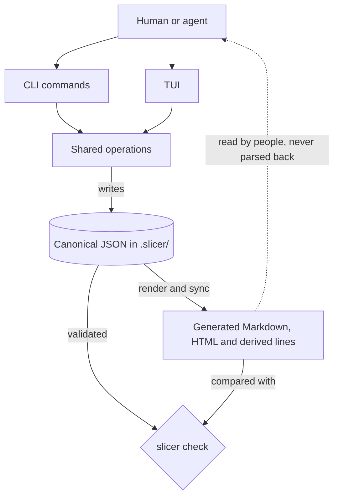
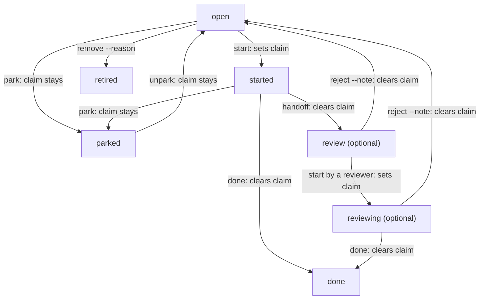

# How slicer works

A plain-language model of slicer, to read before you learn its commands. It explains
what slicer stores, how it decides what you can work on next, how an item moves from
queued to finished, and what is local to your checkout versus shared through git.

This page is a map, not a reference. [Why slicer](why-slicer.md) covers the problems
slicer solves, [Getting started](getting-started.md) is the hands-on walk-through, and
the [command reference](commands.md) and [configuration](configuration.md) hold every
flag and key. Where this page states a rule, the linked page has the detail.

## The model in one paragraph

A project keeps a **queue of items** in git-tracked JSON under `.slicer/`. An item is a
row: a title, a status, some priority numbers and dependencies. An item that is ready to
be worked gets a **slice**, a short specification with named sections. You change both
only through slicer commands (or the TUI). From that JSON slicer **generates** readable
Markdown and HTML and **checks** that the generated files still match. Nothing runs your
work: a person or an AI agent reads the next item, does the work, and tells slicer what
happened.

## What slicer stores

### Items and slices

An **item** is a row in the queue. `slicer add "Title"` creates one with no slice. A
**slice** is the specification behind a row, created with `slicer promote ID` and edited
with `slicer edit ID --section NAME`. It holds a lead, a scope boundary and ordered named
sections (by default Why, Files, Failing tests, Implement, Check and Git).

The two are separate on purpose. A row is cheap to file and enough to track an idea. A
slice is the contract someone implements against.

**In practice:** `slicer next` will offer a row that has no slice yet, and
`slicer next --show` or `slicer next --ready` tells you to run `promote`. Once a slice exists, `next` skips it while its required sections are empty
(by default Implement and Check) and prints which headings to fill. A vague slice stays
out of the queue until someone specifies it. See
[configuration: sections](configuration.md#sections).

Notes, history and provenance sit beside these. `slicer note` attaches a dated note to an
item, and `slicer log` reads the append-only history of every change.

### Goals versus queued tasks

**Goals and non-goals** say what the project is for. They are prose blocks and catalog
records, not items. The **queue** says what is currently planned. Goals do not rank,
block or unblock anything: `list`, `next`, `stats` and `deps` ignore them, and citing a
goal from an item (`slicer catalog cite`) is a reference only.

**In practice:** adding a goal never changes what `next` returns. Use goals to judge
whether something belongs on the queue at all, and ask the owner to set them rather than
inferring them from the backlog. `slicer goals` prints them. See
[goals and non-goals](getting-started.md#goals-and-non-goals) and the
[catalog](commands.md#catalog).

## How the pieces connect

Read it top to bottom. A person or an agent drives slicer through the command line or
the terminal UI. Both call the same operations, so they cannot disagree about what a
change means, and those operations are the only code that writes the canonical JSON.
Every read command (`list`, `next`, `show`) reads that JSON and prints.

Generated output flows one way. `slicer render` projects the JSON into Markdown and a
browser view under `.slicer/render/`, and `slicer sync` rewrites configured lines in
documents slicer does not own. `slicer check` validates the JSON itself for integrity,
rebuilds what the generated files should contain, and compares that with what is on disk,
sync targets included. Slicer never reads generated files back as input.
A hand edit to one is reported by `check` and overwritten by the next `render`.

Two ways in look like exceptions but are not. `import` reads an outline you wrote, and
`migrate` reads a legacy tree of Markdown slices. Both are one-time ramps from your own
documents, never from slicer's own render. See [the outline format](import.md) and the
[legacy format](migrate-format.md).

**In practice:** edit state with commands or the TUI, commit `.slicer/` including
`render/`, and let `slicer check` in CI catch a stale render. Never edit a file under
`.slicer/` by hand. See [what lives in `.slicer/`](commands.md#what-lives-in-slicer) and
the [architecture notes](../ARCHITECTURE.md#shape).

## What you can work on: readiness

Readiness is **computed**, never stored. `slicer next` and `slicer list` work it out each
time from the current JSON. A row can fail to be ready for these reasons:

| Why `next` skips it | What to do |
|---|---|
| Its status is not open or started: parked, in review, done, retired, or a custom status such as `later` (shipped by default) or one you add | `slicer unpark ID`, or `slicer set ID --status open`. Review work is found with `next --status review` |
| A dependency is not finished (`list` marks the row `!`; `slicer deps ID` names it) | Finish the dependency, or change the edge with `slicer set ID --depends-on ...` |
| A required section of its slice is empty (`next` prints which) | `slicer edit ID --section Implement --text ...` |
| It has unfinished slivers, smaller items carved from it | Finish the slivers. See [slivers](commands.md#slivers) |
| A sibling git worktree on this machine has it claimed or started (`list` shows `wt:NAME`) | Talk to whoever holds it, or pick another item |
| You passed a filter such as `--tree`, `--size`, `--flag` or `--max-attempts` | Drop or change the filter |

Dependencies are a hard gate. By default only `done` satisfies one, so an item in review
still blocks its dependents. A project can list more satisfying statuses with
`satisfies_dependencies`; see
[dependencies and integration](configuration.md#dependencies-and-integration).

**In practice:** when the row you want is not offered, read what `next` skipped before
changing anything. The reason is almost always one line, and the fix is a
status, a dependency or a section, not a reorder.

## Which one first: priority

Each item has an **importance** and an **urgency**, each 1 to 3, with a default of 2.
Its score is `importance * 10 + urgency`, so importance leads and urgency breaks ties.
**Effort** is a separate 1-to-3 estimate. It is not part of the score and does not change
what `next` returns. Use it to sort (`slicer sort --by effort`) and to choose agents in
the [relay roles](commands.md#relay-roles) matrix.

The **effective priority** is the score after inheritance. A blocker takes the highest
score of anything that depends on it, because the important work cannot start until the
blocker is done. `next` then orders what is ready like this:

1. Items already started, before any open item.
2. Declared passes, in the order the roadmap declares them.
3. Effective priority, highest first.
4. Stored queue order, which breaks ties and changes only with `move` and `sort`.

**In practice:** if the wrong item comes first, look at its importance, urgency and
dependencies with `slicer list` and `slicer show`. Changing a score reorders `next` but
never rewrites the stored queue. See [priority](commands.md#priority) and
[picking and listing work](commands.md#picking-and-listing-work).

## Status, readiness and claim are three things

New users often treat these as one. They are stored and computed differently.

| | Where it lives | Who changes it | What it tells you |
|---|---|---|---|
| **Status** | Stored on the item | `start`, `handoff`, `reject`, `park`, `unpark`, `done`, `remove`, `set --status` | Where the item is in its lifecycle |
| **Readiness** | Computed on every read | Nothing directly: change status, dependencies or the slice | Whether `next` would offer it |
| **Claim** | Stored on the item as an owner and a time | `start` sets it, as do `next --start` and claiming from a custom queue. `release`, `handoff`, `reject` and `done` clear it | Who said they are working on it |

Consequences you can see:

- `park` changes the status and leaves the claim. A parked item still names its owner
  until someone runs `slicer release ID`. `unpark` likewise returns it to open with the
  claim still in place.
- `release` clears the claim and leaves the status. A started item stays started.
- `start` does not check readiness. You can start a blocked item or one whose slice is
  empty, so check `next` first.
- A claim is a label, not a lock. A second `start` by another owner succeeds and the
  first owner's claim stays. Slicer warns when another branch or worktree on this machine
  already names the slice.

## Statuses are configuration

The lifecycle names (open, started, review, reviewing, parked, done, retired) are
**roles** that `.slicer/config.json` maps to status keys, and each key has a label that
the generated files show. Defaults ship with `slicer init`, and a project can rename a
label, drop `parked`, or add its own status such as `blocked` to hold an item out of
`next`. A fresh project already ships `later` for that purpose. A custom status stays out of the queue until you move the item, or draw from it
with `next --status NAME`.

**In practice:** a status label in a roadmap may not be the word you expect, so read
`slicer config` for the project's own. Renaming a label only needs a re-render. Changing
a key can strand files. See [statuses](configuration.md#statuses) and
[the surprising keys](configuration.md#the-ones-that-will-surprise-you).

## The lifecycle

Arrows are commands and boxes are the default status keys. The boxes marked optional,
review and reviewing, are used only by projects whose workflow goes through review.

The plain path is `open`, then `start`, then `done`. In between, `release` drops a claim
without moving the item. When the work is done, `slicer done ID` moves the status to
`done`, clears the claim, moves the slice file to `.slicer/slices/done/` and lets
dependents start.

The review path adds three commands. `handoff` moves a started item to `review` and
clears the claim; it needs a slice, and a project can also require an item note of a set
kind first (`handoff_requires_note_kind`). A reviewer finds it with
`slicer next --status review` and runs `start`, which moves it to `reviewing` with their
claim. The reviewer then runs `done` to accept it or `reject --note "verdict"` to send it
back. `reject` needs a verdict, records it as a note on the item, clears the claim and
returns the item to `open`, or to a status you name with `--to`. The implementer picks it
up again from the normal queue.

`park` sets work aside and `unpark` returns it to `open`, not to `started`. Parked items
are listed last and never offered. `slicer remove ID --reason "..."` retires an item: the
status becomes `retired`, the slice moves to `.slicer/slices/retired/` and the id stays
taken. It refuses an item that is done or that others depend on unless you pass `--force`.
`remove --purge` deletes a mistaken row outright. See
[removing an item](commands.md#removing-an-item).

Slicer does not enforce every step of the diagram. `done` works from any status, so a
project can finish work it never started in slicer. Some commands do refuse, and change
nothing when they do: `handoff` needs a started item, `reject` needs an item in
review, and `done` and `handoff` refuse a parent while its slivers are unfinished
(`slivers_open`).

### What "finished" means: two finish policies

The project setting `implement_finish` is `done` by default and can be `handoff`. It
decides which command an implementer treats as the last step.

| | `implement_finish: done` (default) | `implement_finish: handoff` |
|---|---|---|
| The implementer ends with | `slicer done ID` | `slicer handoff ID` |
| After that the item is | `done`, unblocking dependents | `review`, still unfinished, dependents still blocked |
| `done` is run | by the implementer | after review, when the project accepts the work |
| Review and `reject` | available; the instructions name handoff only as the step for handoff projects | the expected path |

Under either policy, an item is finished only when its status is `done`. Handoff means
"ready for someone else to judge", not finished.

The setting changes what `slicer ai instructions`, `slicer ai skill` and `slicer ai relay`
tell an agent to run last. It does not make slicer refuse a command: `done` still works in
a handoff project, and `handoff` works in a done project as long as a review status is
configured. It also decides when a sliver releases its parent in `next`. A handoff
project needs a non-empty `review_status`. See
[implement_finish](configuration.md#every-key) and [the loop](getting-started.md#6-the-loop).

## Git, local state and shared state

Slicer keeps no server and no database. The canonical state is JSON in your checkout, so
it behaves like the rest of your code.

- **Branch-local.** State belongs to the branch you have checked out. An item you start
  on a feature branch is started only there. Switching branches switches the roadmap.
- **Shared through git.** What other people and agents see is whatever you committed and
  they pulled or merged. Claims are part of that state. Two branches that file items or
  edit the same row can conflict like any file, and `slicer setup-git` prints the merge
  drivers that resolve independent changes automatically. See
  [what lives in `.slicer/`](commands.md#what-lives-in-slicer).
- **Visible on this machine only.** `next`, `list` and `start` also read the other git
  worktrees of this repository on the same computer, read-only, so you see `wt:NAME` and
  a warning. Nothing from another machine appears until it is committed and merged.
- **Local-only extras.** The `feedback` log and the `relay-run` ledger are not roadmap
  state. They are gitignored or kept in the git directory.
- **Slicer never commits, pushes or tags.** You or your agent do that with git. It
  limits itself to a read-only git allowlist. See [git access](commands.md#git-access).

Slicer is not a real-time collaboration tool. Two people editing at the same moment
meet at a merge, not in a shared session. Slicer also does not run your agents. Commands
such as `slicer ai instructions` and `slicer ai relay` print text for an agent session
that a person or tool starts, and `relay-roles recommend` only suggests a lineup; nothing
in slicer launches, schedules or supervises that work.

**In practice:** commit tracking changes with the work they describe, re-run
`slicer render` after resolving a merge, and treat a claim as a note to teammates, not a
reservation. `slicer verify --landed ID` checks that a done item is in a ref's history.

## Which commands change what

| What you change | Commands |
|---|---|
| What exists | `add`, `import`, `promote`, `edit`, `set`, `note`, `move`, `sort`, `remove` |
| Direction and prose | `prose`, `catalog` (`goals` only reads) |
| Where an item is in its life | `start`, `release`, `handoff`, `reject`, `park`, `unpark`, `done` |
| Generated output | `render`, `sync` |
| Nothing (reads and checks) | `next`, `list`, `show`, `deps`, `find`, `stats`, `status`, `log`, `check`, `verify` |

Commands that change roadmap items, such as `add`, `set`, `edit`, `start` and `done`,
accept `--render`, so one step can change state and refresh the projection. Add `--strict`
with it to roll the change back if the render fails. Not every command that writes takes
`--render`; check `--help`. The full list,
with flags, is in the [command reference](commands.md#commands).

## Where to go next

- [Getting started](getting-started.md) to set up a project and run the loop.
- [Command reference](commands.md) for every command and flag.
- [Configuration](configuration.md) for statuses, sections and finish policy.
- [Driving slicer from an agent](agents.md) for JSON contracts and exit codes.
- [TUI manual](tui.md) for the interactive front end.
- [ARCHITECTURE.md](../ARCHITECTURE.md) for how the source is layered.
