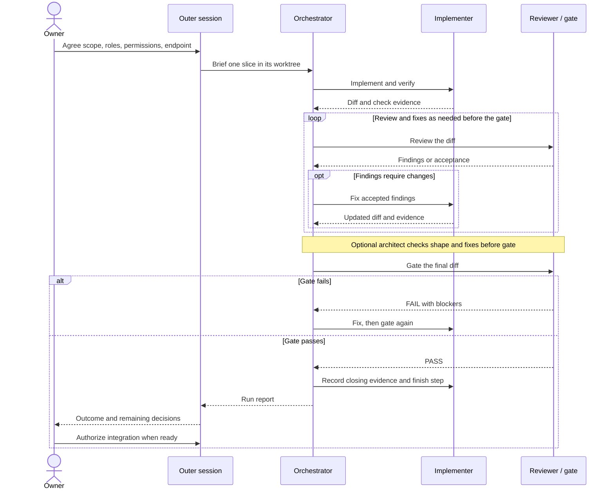

# Working with agents

You decide what work is worth doing, what counts as evidence, and when to integrate
the result. An agent can investigate, propose a plan, implement it, and review it;
slicer stores and reports the agreed work. It does not launch agents or call AI
services. You run those sessions through your chosen agent harness.

If slicer is new to you, start with [Getting started](getting-started.md). The
[agent reference](agents.md) covers prompts and JSON contracts; this guide covers
the decisions and observations that remain yours.

## Agree on the work

Tell the agent the goal, constraints, workspace boundary, and actions it may take.
Name any limits on dependencies, cost, network access, commits, and publication.
Read the project's instructions together. Missing acceptance criteria or a choice
between different product behaviours needs your answer before implementation.

For an existing project, ask for findings tied to source locations, observed
behaviour, and checks that demonstrate the problem. Compare each accepted finding
with the existing roadmap: keep supporting evidence, reject unsupported claims,
and extend an existing item where it already covers the work. An agent's review
is input to your priorities, rather than authority to add every suggestion.
The [worked workflows](agents.md#worked-workflows) show planning and filing examples.

Approve a bounded specification before starting: why it matters, files affected,
dependencies, explicit exclusions, and acceptance checks. A roadmap row still
needs a specification. A slice being ready for pickup means its required sections
and dependencies allow work; it does not mean you have approved its design.

Choose how to implement it:

- **Manually:** use slicer to track work you perform and check yourself.
- **One agent:** give it one slice and the project's instructions; review its
  evidence and diff yourself.
- **A relay:** use separate implementation and review roles, with an orchestrator
  coordinating one slice and an outer session talking to you. This adds review
  rounds and coordination; decide whether the slice warrants that effort.

## Set up a relay

Read the generated [agent instructions and relay contracts](agents.md) from your
installed slicer. These commands are the authoritative workflow for that version
and project; this guide is an explanation, not a replacement:

```sh
slicer ai instructions
slicer ai relay
slicer ai relay-orchestrator
slicer config implement_finish
```

Before creating the worktree, agree with the outer session on the roles, whether
implementation is split or slivered, the environment and scratch directories, and
the endpoint. The architect is optional under the live relay contract: you decide
whether to include architecture review. Confirm the agent, vendor, model and
reasoning effort for every role, including the orchestrator. Use the project's
[role recommendations](commands.md#relay-roles) rather than a model list copied
into a guide. For a well-specified whole slice, replacing `S01` with its ID:

```sh
slicer relay-roles recommend S01 --well-specified yes --split no
```

Read the proposed lineup and alternatives, then accept or override it. Accepting
the lineup alone does not authorize paid sessions, commits, or landing. Explicitly
agree whether this run stops after the project's finish step, after a branch
commit, or after landing. Your authorization and the project policy govern what
the sessions may do.



In prose: the outer session agrees the setup with you and gives one slice to an
orchestrator. The implementer produces the diff and check evidence. A separate
reviewer examines it; accepted findings return to the implementer for fixes,
then another review or the gate. An architect, if chosen, checks the shape and
confirms fixes before the gate. A failed gate returns to implementation and another gate; a pass
allows the closing note and configured finish step. The outer session receives
the report and carries out only the endpoint you authorized. The contract also
defines when repeated failures or a missing owner decision stop the relay.

Every review, UI pass and gate finding is a `fix` (back to the implementer), an
`owner` question (a design call for you, with 2 to 4 options and a recommendation;
it blocks the gate only when marked `blocker`) or a `later` follow-up with a one-line
title. The run report lists your questions as numbered lines you can answer by
number. A `Review FAIL` note appears only after a `VERDICT: FAIL`.

## Inspect progress

Run these from the project or slice worktree you want to inspect. Different
worktrees can have different tracking state; use `slicer --root PATH` to select
one explicitly. Replace `S01` with the slice ID and `RUN` with an ID returned by
the run list. These recipes only read state.

```sh
slicer status
slicer show S01 --json --lean
slicer log --item S01 --limit 20
```

`status` gives a project census, the next item and blocked work. `show` supplies
the slice, current status, dependencies, claim and notes. Use it to compare the
agreed checks with the evidence the session reports. `log` shows recorded changes,
including starts, handoffs and rejections, so you can follow a retry without
mistaking an earlier attempt's result for the current one. These are records of
work, not proof that an agent process is still alive or that its checks passed.

```sh
slicer relay-run list --active
slicer relay-run list
slicer relay-run list RUN --json --lean
```

The [run ledger](commands.md#relay-run-ledger) shows recorded roles, steps and
outcomes. `--active` keeps unended runs with an event in the last 30 minutes.
Use the unfiltered list to find ended or stale runs too. Stale means no recent
recorded event, not a confirmed crash. A role marked done means its step ended;
read its report to learn what it established.

For an interactive view:

```sh
slicer tui
```

Press `b` for the [relay board](tui.md#relay-board). Inspect the running role,
round, task, last-heard time and any recorded gate failure reason. Scroll with
`j`/`k` or arrows; close the board with `b`, `q` or Esc. Ended runs remain as
summaries for one hour, then leave the board; use the CLI list for older runs.
The board reads recorded events. Missing or delayed recording limits what it can
show; it neither starts nor stops nor steers the agent processes. Bring a concern
to the outer session through your harness.

Look for work waiting on you by comparing the session's question or report with
the slice and history. Review status indicates a handoff needing review or
integration attention. An explicit request for a scope, permission, or design
decision needs your answer. A stale lane or failed gate calls for investigation;
neither by itself identifies an owner decision. The board is not a complete inbox
of human approvals.

## Review the evidence and decide what happens next

Read the diff alongside the specification and report. Check that the exclusions
were honoured, the checks exercise the claimed behaviour, failures were resolved,
and remaining risks are explicit. For code changes, the relay report should include
observed failing tests, final test counts and mutation checks; for documentation,
look for verified commands, links and rendering evidence. `slicer check` verifies
tracking integrity and generated output, not application correctness.

A failed review should state a concrete blocker. The
[review lifecycle](commands.md#review-lifecycle) records rejection and returns the
item for another attempt. If handoff fails, inspect its diagnostic: a required
current-attempt report or a tracking check may be missing. Resolve the stated
problem and verify the resulting state instead of treating the attempted command
as a successful handoff.

Keep these four questions separate:

| Question | Evidence to inspect |
|---|---|
| Did the relay pass? | The gate verdict for the reviewed diff and the run report. A recorded run outcome summarizes the run. |
| Was work handed off? | The selected worktree's item status, notes and handoff history. Review status alone does not establish a gate pass. |
| Was the branch integrated? | Git history and the integration diff. Neither a gate pass nor a handoff proves a merge. |
| Is the slice complete? | The project's finish policy and recorded completion in the intended checkout, after any required review and integration. |

Read `implement_finish` before interpreting success. With `handoff`, the
implementer finishes in review; a handoff project records `done` after review
and merge. Slicer's own repository procedure is [Landing a slice](landing.md).
With the default `done` policy, the implementation finish records completion,
but still does not merge a branch. Status names and review requirements are project configuration.

Decide explicitly whether to accept the result, request more work, or authorize
integration. Confirm what remains: a commit, merge, completion record, worktree
cleanup, or publication may still be separate steps. A successful relay does not
grant permission for any of them. Keep deferred findings on the roadmap only
after reviewing their evidence and scope, just as you did before this run.
